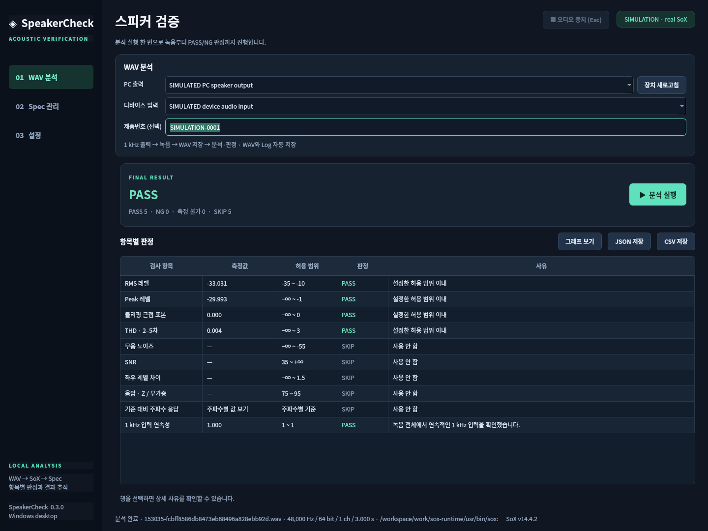

# SpeakerCheck 0.3.0

**WAV 분석 화면에서 분석 실행 한 번:**

**PC 1 kHz 출력 → 디바이스 입력 녹음 → WAV 생성 → SoX 분석 → PASS/NG → Log 자동 저장**

별도 자동 녹음·양산 메뉴를 없앴습니다. 녹음 조건·저장 위치·시험 이력은 설정으로 옮겼고, 그래프는 기본 접힘입니다.

## 다운로드

[**0.3.0 ZIP 다운로드**](https://github.com/threej22/Test/raw/refs/heads/main/SpeakerCheck-0.3.0-source.zip)

새 폴더에 **전체 압축 해제** 후 `setup.bat` → `start.bat`를 실행하세요. ZIP 루트에 `launch.py`와 `speakercheck/` 폴더가 함께 있습니다. 실행기 경로 설정과 패키지 누락 안내를 보완했습니다.

Python 3.11 이상과 별도 SoX 설치가 필요합니다. 설정에서 `sox.exe`를 지정하고, 메인에서 입출력 장치를 선택한 뒤 실제 제품 Spec을 설정하세요. 이후 분석 실행만 누르면 됩니다. 제품번호는 선택이며 비워 두면 시험번호가 자동 생성됩니다.

WAV/SQLite/작업 로그는 자동 저장합니다. 설정의 시험 이력에서 검색·CSV·JSON 저장이 가능합니다. 중단/장치/로그 오류는 PASS로 처리하지 않습니다. 기존 WAV 분석은 설정에서 명시적으로 선택할 수 있습니다.

테스트 **69개 통과**, 새 ZIP을 실제 추출한 뒤 외부 작업 폴더/Python -I에서 앱 모듈 import 확인. Linux의 합성 오디오 backend + 실제 SoX/SQLite/Qt로 검증했으며 **실제 Windows 오디오 장치 및 EXE 실행은 미검증**입니다. 디바이스가 Windows 녹음 장치로 인식되어야 합니다.

ZIP SHA256: `530a3aa3e6cd3410a1533ad8c9d5e750365748ff5f93a2371837f21f913c2ad7`
